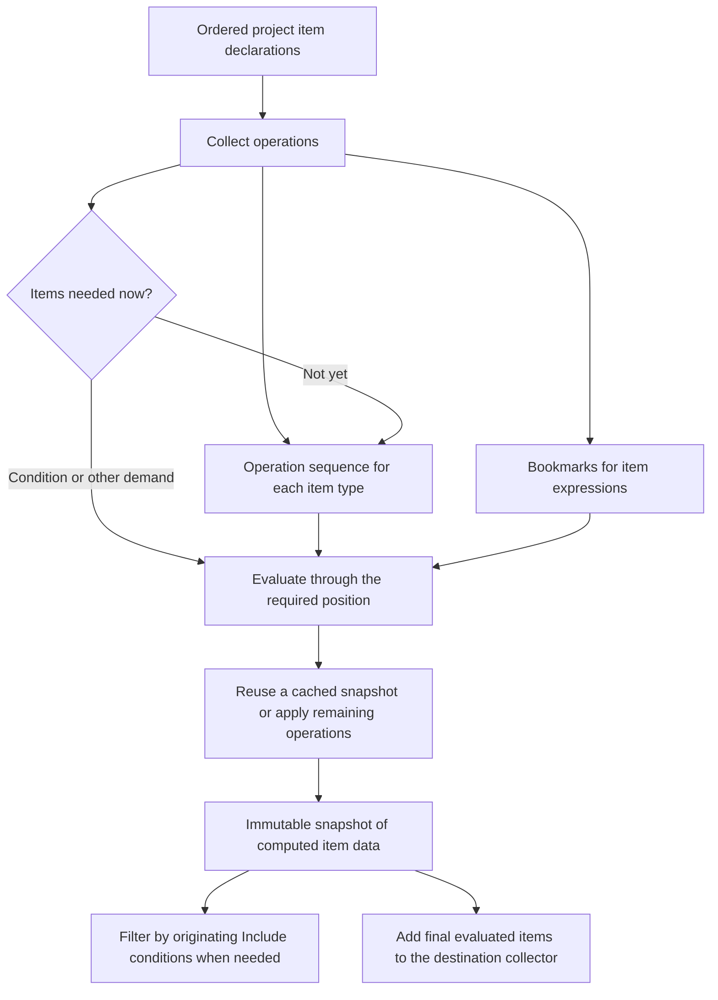

# Item evaluation: concepts, execution, and ownership

## Purpose and scope

This document explains how project-level item evaluation works, from collecting Include, Update,
and Remove operations to adding evaluated items to the destination project data. It describes the
responsibilities of the evaluator, operation sequences, bookmarks, matchers, snapshots, and caches.

The focus is `LazyItemEvaluator` and its integration with the surrounding MSBuild evaluator.
Property evaluation, expression expansion, filesystem matching, and execution-time item changes are
covered where they establish a boundary or an ownership requirement. This is not a complete
description of target execution or every item-expression function.

The [implementation guide](#implementation-guide) links these concepts to their code. The
[item evaluation benchmarks](../src/MSBuild.Benchmarks/Evaluation/Items/README.md) describe
workloads and measurement boundaries separately.

## Contents

- [The central model](#the-central-model)
- [Terminology](#terminology)
- [Evaluation boundaries and ownership](#where-item-evaluation-fits)
- [Collecting an operation](#collecting-an-operation)
- [Bookmarks](#bookmarks)
- [Item specifications and matchers](#item-specifications-and-matchers)
- [Evaluating an operation sequence](#evaluating-an-operation-sequence)
- [Include](#applying-an-include), [Update](#applying-an-update), and [Remove](#applying-a-remove)
- [Update batches](#update-batches) and [metadata evaluation](#metadata-evaluation)
- [Snapshots and shared storage](#snapshots-and-shared-storage)
- [Snapshot caching and replacement](#snapshot-caching-and-replacement)
- [Later Remove glob patterns](#later-remove-glob-patterns)
- [Adding final items to the destination](#adding-final-items-to-the-destination)
- [Related consumers and system boundaries](#related-consumers-and-system-boundaries)
- [Worked example](#worked-example-collection-bookmarks-and-evaluation)
- [Architectural invariants](#architectural-invariants)
- [Implementation guide](#implementation-guide)

## The central model

The evaluator collects operations in declaration order. When an item state is needed, it evaluates
the corresponding operation sequence through the required position.

Collection and evaluation are not two completely separate whole-project phases. A condition,
an item expression, or collection-time metadata matching can require evaluating operations already
collected. Collection then continues.

Each item type has its own operation sequence. A declaration using another item list keeps a
bookmark identifying the position of that list visible at the declaration. Later operations cannot
move that bookmark.

Evaluation produces immutable snapshots of computed item data. The evaluator reuses cached snapshots
where their ending operation and later Remove glob patterns are compatible with the computation.
Later evaluation shares unchanged data and clones items before changing their metadata.



## Terminology

### Operations and item states

**Item operation.** An operation representing an Include, Update, or Remove declaration for an item
type. Creating an operation does not necessarily apply its effects. The base type is
`ItemOperation`.

**Operation sequence.** The ordered sequence of collected operations for one item type. Later
declarations append to the sequence. It can contain operations that have not yet been applied.

**Collecting operations.** Creating operations and appending them in declaration order, while
preserving the conditions, parsed expressions, and item-list bookmarks needed for later evaluation.

**Item state.** The ordered items and their metadata after evaluating an operation sequence through
a particular position. This is the logical result, not a particular storage representation.

**Bookmark.** An operation sequence and a fixed position within it, identifying an item state that
can be requested later. Creating the bookmark does not itself evaluate or copy items.

**Snapshot.** An immutable ordered collection of computed item data. An intermediate cached snapshot
may omit filesystem glob results because later Remove operations will discard them. It therefore
does not necessarily represent the complete item state at its ending position considered on its own.

**Current snapshot.** A snapshot representing the operation sequence's current item state. If more
operations have been collected, the last computed snapshot can be a previous snapshot rather than
the current state.

**Previous snapshot / cached snapshot.** Descriptions of snapshots retained for possible reuse,
not separate types of state.

### Specifications and matching

**Item specification.** The expression supplied to an Include, Update, or ordinary Remove attribute.
An item specification stores its original text and property-expanded fragments, not evaluated
item-list contents.

**Fragment.** One component of an item specification, separated by semicolons outside item-vector
expressions. Fragments represent literal values, glob patterns, or item-vector expressions.

**Matcher.** Code that determines whether an item matches an item specification using a particular
expansion context. Parsed syntax and its context-dependent matching state have different owners.

**Later Remove glob patterns.** Parsed glob patterns from applicable ordinary Remove operations
later in the portion of a sequence being evaluated. Earlier filesystem Includes can use them to
skip unnecessary results. They are not the Include's own Exclude patterns or all possible Remove
matching criteria.

**Update batch.** An internal grouping of eligible literal Updates affecting disjoint normalized
item paths, allowing their effects to be applied in one pass over the items. This is not MSBuild's
metadata-driven task batching.

### Items and their declarations

**Originating Include.** The Include declaration that originally created an item. Later Updates
preserve this association. It identifies the original declaration, its evaluated condition result,
and its declaration order.

**ItemData.** An evaluated item and its association with its originating Include, plus derived
implementation data such as a lazily cached normalized path key.

**IncludeData.** The originating Include's XML element and the condition result established while
collecting that operation.

**Filtered items.** The items from a snapshot whose originating Include condition evaluated to true.
`GetFilteredItems` returns an item collection, not another snapshot.

**MatchingItems.** For a qualified Update, the last matching item of each relevant item type used
to resolve qualified metadata. These are actual evaluated items, not bookmarks.

### Evaluation activities

| Activity | Meaning |
| --- | --- |
| Evaluate an operation sequence | Obtain the requested result, potentially using a cached snapshot. |
| Apply an operation | Perform that operation's effects. |
| Re-evaluate operations | Apply previously collected operations again when a suitable cached result is unavailable. |
| Enumerate evaluated items | Read the items already represented by a result. |
| Add evaluated items to a collector | Transfer evaluated items into the destination's collections. |

A request answered entirely from the cache does not re-evaluate operations.

## Where item evaluation fits

The outer `Evaluator` controls the project-evaluation passes. Before project-level items are
evaluated, it has initialized properties, processed properties and imports, and evaluated item
definitions. Item groups follow the order established by that traversal, including imports.

The item pass creates a `LazyItemEvaluator` with:

- The outer evaluator data, including properties and item definitions.
- An item factory for the concrete item representation.
- Logging, profiling, filesystem, and evaluation-context services.
- Optional destinations for information about evaluated item declarations.

`LazyItemEvaluator<P, I, M, D>` is generic over the property, item, metadata, and item-definition
representations. The same operation model supports editable project items and instance-model items
through their interfaces and factories.

The outer evaluator asks it to:

1. Process the ordered item groups and collect their operations.
2. Compute the final item states and add their items to the outer evaluator data.

Requested item-glob information is synthesized afterward. Subsequent evaluation passes do not need
the lazy evaluator's private operation sequences or snapshot cache. Normal project reevaluation
creates new evaluation state rather than treating this cache as a persistent cross-evaluation cache.

ItemGroups inside targets use a different execution-time mechanism, described under
[related consumers](#related-consumers-and-system-boundaries).

## Responsibilities and ownership

| Component | Responsibility and owned state |
| --- | --- |
| Outer `Evaluator` | Evaluation-pass order, imported declaration order, item definitions, and the final destination data. |
| `LazyItemEvaluator` | Operation sequences by item type, the ordered Include table, the shared snapshot cache, and current-item access during collection. |
| `ItemOperationSequence` | Append-only operations for one type, later Remove pattern storage, and tracking of the most recent successful current-state computation. |
| `ItemOperation` | One declaration's condition result, bookmarks, operation-bound expander and factory wrapper, and operation-specific data. |
| `ItemListBookmark` | A shared sequence reference and a fixed operation count. No computed items. |
| `ItemListBookmarks` | A read-only mapping from item type to bookmark, also implementing `IItemProvider`. |
| `ItemSpec` and fragments | Parsed syntax and the directory/location needed to interpret it. No mutable expansion results. |
| `ItemSpecMatcher` | Resolved vector values and compiled matching state for one fixed expansion context. |
| `QualifiedUpdateMatcher` | Update matching plus matching items for qualified metadata, with a literal index or ordered fallback. |
| Snapshot and builder | Frozen computed item data versus mutable construction of a subsequent result. |
| `IItemEvaluationCollector` | Destination-specific handling of normal and design-time item collections. |

These are ownership boundaries, not promises that every component is thread-safe. Sequence
evaluation, mutable builders, operation expanders, matcher caches, and the evaluator cache use
evaluation-local mutable state.

## Collecting an operation

### Conditions are evaluated at the declaration

For each item group, the evaluator evaluates the group's condition using the items visible at
that point. For each processed item element, it similarly evaluates the element's condition.

The normal path skips declarations whose conditions do not allow them to participate. Design-time
settings can request that false-condition declarations also be processed. An operation's saved
condition result combines the item-group and item-element results.

Condition expressions use the evaluator's current-item provider. Reading `@(Compile)` can therefore
evaluate the `Compile` sequence collected so far. It does not create a bookmark simply because
the condition needs the current state.

The condition result belongs to this collected occurrence of the declaration. Re-evaluating the
operation does not reevaluate its item-group or item-element condition.

### Construct before append

The evaluator constructs the operation, including its bookmarks, before appending it to the
destination item type's sequence.

For example:

```xml
<ItemGroup>
  <Compile Include="a.cs" />
  <Compile Include="@(Compile)" />
</ItemGroup>
```

The second Include's bookmark refers to the first Include's position. It cannot include the
operation currently being constructed. This ordering also applies when an Update or Remove
references its own item type.

Operation positions are represented as counts. A bookmark with count `N` includes the first `N`
operations, not operation `N` in zero-based indexing. Count zero identifies the empty state.

### Parse specifications and discover item dependencies

Include, Update, and ordinary Remove specifications are parsed after property expansion. The
evaluator finds item-vector fragments and creates bookmarks for their referenced item types.

Includes also retain property-expanded Exclude strings and discover the item references needed
when those strings are evaluated later.

Metadata declarations remain in declaration order. Dependency discovery examines both their values
and conditions for item-vector references, including references introduced by property expansion.
This discovery is not final metadata evaluation. The discovery pass deliberately leaves a property
unexpanded on certain property-function errors involving still-unexpanded metadata; actual metadata
evaluation retains responsibility for the eventual result or diagnostic.

The operation receives an independently owned bookmark mapping. The implementation uses empty,
singleton, small-map, or dictionary storage according to the number of item types. Temporary pooled
storage is not retained by the completed mapping. Missing item types return an empty collection;
they do not start referring to a type that appears later.

### Keep the appropriate expansion context

There are three important uses of item providers:

| Use | Items visible to expressions |
| --- | --- |
| Parsing property-expanded syntax | The outer property-expansion context; item vectors are parsed, not resolved. |
| Item-group and item-element conditions | Current states of the sequences collected so far. |
| Applying a deferred operation | States identified by that operation's bookmarks. |

Each operation owns an expander using its bookmark provider. The original property provider is
shared with outer evaluation, but item access must not silently switch from bookmarked states to
the evaluator's later current state.

The item-factory wrapper similarly restores the operation's XML element before delegating item
creation or metadata assignment to the shared concrete factory.

## Bookmarks

Creating a bookmark stores a reference to the shared sequence and its current operation count.
It also marks the ending operation, if any, as a position whose computed snapshots may be needed
again. It neither evaluates the sequence nor copies items.

The bookmark's position remains fixed when the sequence grows. Its reference is to the sequence
object, not to a truncated copy of the sequence's storage.

`ItemListBookmarks` resolves an item type by asking its bookmark for filtered items. Evaluating a
bookmark can reuse an appropriate snapshot or apply operations through that bookmarked position.
It never applies operations beyond that position.

The evaluator, rather than the bookmark, owns the snapshot cache. Multiple bookmarks at one position
share the ending operation's marking. The current implementation does not reference-count bookmarks
or remove that marking as individual operations finish.

This is not a guarantee of minimal object retention. A bookmark references its shared sequence,
which references the evaluator. Its fixed count limits evaluation, not the physical objects
reachable through those references.

## Item specifications and matchers

### Syntax is separate from results

For this specification:

```xml
<Compile Remove="obsolete.cs;*.g.cs;@(Generated)" />
```

the parsed fragments are:

| Fragment | Meaning |
| --- | --- |
| `obsolete.cs` | Literal value. |
| `*.g.cs` | Glob pattern. |
| `@(Generated)` | Item-vector syntax, resolved using the consumer's provider. |

Properties expand before fragment classification. Semicolons outside item-vector expressions
separate fragments; surrounding whitespace and empty fragments are discarded. Item-vector syntax
can include transforms, functions, and an explicit separator.

Escaping is part of the representation. Literal and vector text remains escaped; parsed glob text
is unescaped. Escaped wildcard characters prevent a fragment from being classified as an ordinary
glob. Consumers must not indiscriminately unescape all text and reclassify it.

Parsing does not enumerate files or obtain item-vector results. Syntax can be shared without
sharing the context-dependent results of expanding or matching it.

### Ordinary matching

An operation or query creates its own `ItemSpecMatcher` for a fixed expansion context. The matcher
owns derived state, such as resolved item-vector values and compiled literal/glob matchers.

Matching one item visits fragments in order and stops at the first successful match. Unvisited
vectors need not be resolved. A query asking for all matching fragments or counts must inspect
all relevant values, including duplicate vector values.

Ordinary matching only needs resolved text. Its vector-value cache does not retain the evaluated
items that supplied that text. Qualified Update matching has a different requirement and a
different owner, described below.

Update and Remove glob matching tests existing item identities. It does not enumerate the
filesystem to discover new items. An Include glob, by contrast, can enumerate files to create items.

### Other matcher operations

The same matcher supports:

- Finding which fragments match an identity and counting matching occurrences.
- Matching a specification against an index of normalized existing item paths.
- Building a glob predicate from a specification without enumerating files.
- Collecting literal/pattern strings, substituting resolved values for vectors.

A matching occurrence count can exceed the number of returned fragments because one vector
fragment can contribute several matching values.

Derived caches are valid only while the matching context stays fixed. Sharing parsed syntax is
different from sharing a matcher across changing item providers.

## Evaluating an operation sequence

An evaluation request identifies a position in one item type's operation sequence. Current-item
requests use its current count; bookmark requests use the stored count.

For an empty sequence, the result is the shared empty snapshot. Otherwise, the evaluator first
checks for a cached complete result at the requested ending operation, with no patterns from
Removes beyond that request.

If that result is absent, evaluation has two traversals:

1. Search backward for the nearest reusable cached snapshot, collecting the later Remove glob
   patterns relevant to the requested position.
2. Start a builder from that snapshot, or from empty, and apply the remaining operations forward.

The backward search considers positions that can actually have cached results: bookmarked
operations, and the tracked previous current-state result when the later-pattern requirements
allow reuse. It does not build pattern sets merely to probe every unbookmarked operation.

The forward traversal maintains an `UpdateBatch`, completes pending Updates at required boundaries,
and saves snapshots at bookmarked positions. Any remaining batch is completed before returning
the requested result.

The snapshot at an intermediate position represents all effects through that operation under
the applicable later-pattern input, not only that operation's individual additions or changes.

Neither traversal visits operations beyond the requested count. Each operation's bookmarked item
dependencies can cause evaluation of another sequence, or an earlier position of its own sequence.
Because bookmarks are created before appending the operation, those dependencies do not include
the operation currently being collected.

## Applying an Include

An Include creates new items and appends their `ItemData` in fragment/result order.

### Select the items

The Include first evaluates its retained Exclude expressions using its bookmarks, then splits
their expanded results into patterns.

It handles each specification fragment according to its kind:

| Fragment | Include behavior |
| --- | --- |
| Literal | Create an item for the value unless an explicit Exclude matches it. |
| Item vector | Expand through the operation's bookmark provider, copy/create items through the factory, and apply explicit Excludes. |
| Glob | Expand against the filesystem using explicit Excludes and applicable later Remove glob patterns. |

The expression expander handles metadata copying, transforms, and functions for vector Includes;
the lazy evaluator does not implement a separate transform language.

Only the glob-expansion branch uses later Remove glob patterns. Literal and item-vector Includes
are not skipped by this optimization; later Remove operations still apply to their items normally.

When design-time evaluation processes a false-condition Include, a recognized full-filesystem-scan
glob is skipped unless the existing dangerous-glob escape hatch requires evaluating it.

### Apply metadata and save items

The Include applies its metadata declarations to the newly created items, then appends records
associated with its Include-table entry. Even when selection is empty, the constant-metadata path
can still need to evaluate expressions and report errors. An empty item result does not necessarily
make metadata work or diagnostics irrelevant.

Temporary selection and expanded-Exclude buffers can use pooled storage. Completed results own
their data before that storage is returned to the pool.

Explicit Excludes are local to the Include. If filesystem expansion needs to combine them with
later Remove glob patterns, it creates a separate set rather than mutating shared later-pattern
contents.

## Applying an Update

An Update changes metadata on matching existing items. It does not introduce new item identities
or move items to a new originating Include.

False-condition Updates have no effect when applied. On the first true-condition application,
the operation selects and caches its matching strategy and metadata-expansion requirements.

### Ordinary and self-referencing Updates

Ordinary Updates use an `ItemSpecMatcher`. A recognized simple self-reference, such as
`<Compile Update="@(Compile)">`, uses the existing all-items strategy instead.

For each matching item, the Update:

1. Clones the item before changing metadata.
2. Preserves its originating Include and any already computed normalized path key.
3. Creates a new `ItemData` record for the replacement.
4. Evaluates metadata against the replacement item's metadata table.

Unchanged items remain shared. Both ordinary application and `UpdateBatch` use the same
clone-before-metadata-change rule. Mutable temporary item contexts are cleared in `finally`.

The simple-self-reference recognizer excludes transform/function chains but does not disqualify an
explicit vector separator. It is an implementation shortcut, not a separate language definition.

### Qualified metadata and `QualifiedUpdateMatcher`

Consider:

```xml
<ItemGroup>
  <ColorLookup Include="a.cs">
    <Color>blue</Color>
  </ColorLookup>
  <Compile Include="a.cs" />
  <Compile Update="@(ColorLookup)">
    <Color>%(ColorLookup.Color)</Color>
  </Compile>
</ItemGroup>
```

The Update needs more than a yes/no identity match. It must identify which `ColorLookup` item
supplies the qualified metadata value for the `Compile` item being updated.

`QualifiedUpdateMatcher` provides that association when the Update specification contains vectors,
its metadata values or conditions contain qualified metadata, and the existing qualified-metadata
escape hatch permits the behavior.

It can match ordinary literal/glob fragments independently of item-vector fragments. An empty
referenced list must not prevent a literal fragment from matching.

The result contains:

- Whether the item matches.
- `MatchingItems`: the last matching item of each relevant item type.

Last-match selection follows fragment and expanded-item order. It is not simply the first item
whose path matches.

### Literal lookup and ordered fallback

If all expanded vector values are literal identities and their matching directories agree, the
qualified matcher builds a normalized-path index lazily. Each path maps item types to their last
matching items. Completed tables are treated as read-only.

If any expanded value has a real wildcard, or fragment directories require incompatible matching
contexts, the whole operation retains ordered matching. Combining an unordered literal lookup
with wildcard matching must not change which item wins.

The Update fragment's directory determines path interpretation. An item's cached path key may be
reused only when its directory is appropriate; otherwise, matching computes the contextual key.
Escaped wildcard identities are not interchangeable with actual wildcard patterns.

This matcher must retain evaluated-item associations for qualified metadata. The ordinary
`ItemSpecMatcher`, which needs only resolved text, does not own those associations.

### Metadata lookup

Unqualified metadata resolves against the item being created or updated. A qualifier naming that
same item type also uses the operation item. Other applicable qualifiers resolve through
`MatchingItems`. The operation item's own type takes precedence over a same-named external entry.

Missing item types and absent metadata values retain their established expansion behavior,
including the distinction between an absent table and a table returning no value.

## Update batches

Applying many disjoint literal Updates separately would repeatedly scan the same items.
`UpdateBatch` groups eligible Updates by normalized path and applies them in one traversal.

### Eligibility belongs to the operation

An Update lazily classifies its specification on the first batch-admission attempt and caches
the result. It retains either its unique normalized literal keys or a completed rejection.

An empty specification can be admitted without adding keys. Wildcards, escape/metadata syntax,
item expressions, and remaining property-expression syntax prevent literal batching. A literal
`$` or `@` that does not start an expression is not automatically rejected.

Different spellings that normalize to the same path cannot be admitted as distinct keys for one
candidate. Re-evaluating the same operation can reuse its classification and keys.

### Admission is atomic

Before inserting a candidate's keys, the batch checks all of them against pending Updates.
If any key overlaps, admission fails without changing the pending batch.

For example:

```text
Pending Update: b.cs
Candidate:      a.cs; b.cs
```

The candidate must not leave a tentative entry for `a.cs` when its later `b.cs` fragment conflicts.
The evaluator finishes the pending batch and applies the rejected candidate in ordinary sequence
order. A later batch can then begin.

### Boundaries must preserve exact states

Pending Updates are completed before an Include, Remove, or non-batchable Update is applied, and
at the end of the requested computation.

A bookmark ending at an admitted Update also requires completing the batch through that Update
and caching the exact snapshot before later Updates join. The admitted Update is not applied a
second time through the ordinary operation path.

Batch application clears its dictionary for reuse. Disjoint paths justify a shared item scan;
they do not justify skipping bookmark boundaries or changing the per-item metadata result.

## Applying a Remove

There are two distinct Remove mechanisms.

### Ordinary Remove: match item identities

An ordinary specification can mix literals, globs, and item vectors. Matching uses the operation's
bookmarks and the existing item identities, not filesystem enumeration.

A recognized simple self-reference can clear the current builder directly. Otherwise:

- Smaller collections match existing items and remove the selected item objects.
- Collections at or above the configured threshold use a lazy normalized-path index, find matching
  paths, and remove every matching item, including duplicate identities.

Both paths preserve the order of survivors and earlier snapshots. The path index belongs to the
builder, not the immutable snapshot. Additions maintain it; removals update or invalidate it;
metadata-only replacements can retain it when item paths are unchanged.

Only true-condition ordinary Removes with parsed glob fragments contribute later Remove glob
patterns. Literal fragments and item-vector fragments do not contribute, and vectors are not
expanded to discover more patterns for that optimization.

### Metadata Remove: match metadata tuples

A nonempty expanded `MatchOnMetadata` selects metadata matching. The Remove specification must
then consist of item-vector fragments. An empty expanded metadata-name list falls back to ordinary
specification matching; a present attribute alone does not force metadata matching.

Collection performs the following work before the operation is appended:

1. Expand the metadata-name list.
2. Parse and validate the item-vector-only specification.
3. Obtain bookmarks for those vectors.
4. Resolve the matching items and read the selected metadata values into a `MetadataTrie`.

The tuple values are stored at collection time. Later changes to the items supplying them cannot
change the tuples used by this Remove. This work can require evaluating bookmarked lists during
operation collection, even though removing the destination items remains deferred.

Validation and tuple construction also occur for an operation collected under false conditions
in the applicable design-time path. Applying a false-condition metadata Remove does nothing.

Applying the operation tests candidate metadata tuples and removes matching items. It does not
use the ordinary self-reference clear shortcut or contribute later Remove glob patterns.

### Why tuples matter

For metadata names `Group;Key`, stored tuples `(a, x)` and `(b, y)` must not match `(a, y)`.
Independent sets of values for each metadata name would incorrectly accept that candidate.

The trie preserves tuple boundaries and name order. Shared leading values can share nodes;
leaf nodes do not allocate child dictionaries. Construction and lookup use the same ordered names.
Null or empty candidate metadata values do not match.

Comparison options are ordinal case-sensitive, ordinal case-insensitive, or path-like.
Path-like matching normalizes both stored and candidate values against the same directory chosen
when the trie is created, and uses the platform path-comparison policy. It must not depend on
an unrelated later working-directory value.

## Metadata evaluation

Include and Update metadata is applied in declaration order. Metadata element conditions are
evaluated when metadata is applied, unlike the already saved item-group and item-element conditions.

The operation analyzes values and conditions to decide whether metadata must be evaluated
separately for each item. Metadata references, including built-in metadata, require the per-item
path. Qualified Updates additionally supply `MatchingItems`.

Without per-item metadata dependencies, a temporary metadata table lets later declarations refer
to earlier metadata values, and the evaluated metadata is assigned to all selected items through
the concrete item factory. This permits metadata sharing without confusing declaration order.

The operation delegates expression semantics, escaping, built-in metadata, and item creation
to the existing expansion and factory infrastructure. Item-definition defaults have already been
evaluated by the outer evaluator; the concrete item representation supplies their normal inheritance
behavior. They are not reconstructed by the operation-sequence cache.

Dependency discovery while collecting metadata and expression evaluation while applying metadata
are different activities. Discovery cannot be treated as proof that an expression has already
been successfully evaluated.

## Snapshots and shared storage

### What is immutable

A snapshot fixes membership and order. The evaluator also preserves the represented metadata by
cloning an item before applying metadata changes.

The underlying item types are mutable. Snapshot immutability is therefore a combination of
immutable collection structure and evaluator ownership rules, not a type-level freeze of every
reachable object.

Lazy caches for normalized paths or filtered items may be initialized without changing the
snapshot's logical contents. A cached item path assumes identity and project directory remain
unchanged while that record is shared.

### The piece-list representation

`OrderedItemDataCollection` wraps an `ImmutablePieceList<ItemData>`. A snapshot describes ordered
ranges of earlier snapshots and newly owned item storage.

A builder uses a separate editor. It can start with one range of its base snapshot, split or omit
ranges, and append replacement records without copying every unchanged item.

```text
Earlier snapshot: a.cs, b.cs,          c.cs
Later snapshot:   a.cs, b.cs(updated), c.cs
                  shared              shared
```

Creating an immutable piece-list result transfers the editor's current range description and
starts subsequent edits from that result. Cells referenced by an existing snapshot are never
overwritten. An editor may continue filling an array's unused tail; an independently created
editor has its own append storage.

Enumeration follows ranges with an explicit traversal stack. Indexed access follows snapshot
references iteratively rather than recursively. More shared ancestors can still increase the
amount of traversal work; iterative traversal does not imply constant lookup depth.

### Storage lifetime is not logical membership

A range retains the whole earlier snapshot it references, including reachable ancestors.
A range into an array retains the entire array, including cells omitted from the logical result.

Consequently:

- Removing an item from a later result does not prove its earlier object is collectible.
- Removing a snapshot from the evaluator cache does not prove its storage is collectible.
- A caller holding an earlier result keeps that result valid independently of cache membership.

These properties are compatible with immutability. Compaction, ancestry limits, and retained-memory
measurement are separate concerns, not implied features of snapshots or their cache policy.

## Originating Includes and filtered items

Each collected Include gets an evaluation-local entry in an ordered Include table. Its index is
stored in every `ItemData` it creates.

Updates preserve that association when cloning items. A metadata change must not make the Update
element become the originating Include or change defining-project metadata to refer to the Update's
file. Item creation for an Update clone explicitly uses the originating Include's factory context.

The Include table also preserves the combined group/element condition result. `GetFilteredItems`
uses that fixed result to return only items from condition-true Includes. The filtered collection
is cached on the snapshot and reused for subsequent requests.

An immutable item collection returned by filtering is not a new `OrderedItemDataCollection`
snapshot. The operation-sequence cache and the cached filtered collection are related but distinct
pieces of storage.

When design-time settings retain false-condition Includes, their items can exist in snapshots
without appearing in filtered-item requests. False-condition Updates and Removes do not modify
the builder when applied. Final design-time collection routes surviving items according to the
originating Include conditions; it is not a record of every item ever present before a Remove.

## Snapshot caching and replacement

### Cache identity

The evaluator owns a shared dictionary keyed by:

1. The identity of the ending operation.
2. The contents of the later Remove glob patterns used in the computation.

An operation object belongs to its collected occurrence. The cache does not merge unrelated
declarations merely because their XML or text happens to match.

The ending operation identifies a sequence position. The later-pattern contents identify
which filesystem results an earlier Include may have skipped. Both are required for reuse.

### Bookmarked positions

When evaluation reaches a bookmarked operation, it saves the completed snapshot at that position.
The same position can have more than one cached snapshot with different later-pattern contents.

Direct evaluation of a bookmark requests the complete state through that position. Patterns from
operations beyond the bookmark do not participate. Reading a bookmark does not replace the
sequence's tracking of its most recent successful current-state computation.

### Current-state requests

A condition read or final item collection can request the current state without creating a
bookmark. The evaluator caches the completed current result for repeated reads.

After a newer current result is computed successfully, the sequence removes the previous
current-only cache entry if its ending operation is not bookmarked. It removes the entry
with no later-pattern input, not every cached result associated with that operation.

The sequence updates its tracking only after successful computation. If the replacement fails,
the previous snapshot remains available for another attempt. Previously returned collections
remain valid after their cache entries are removed.

There is one replaceable current-state cache entry per item type, not a rule that only one
snapshot may exist per type. Bookmarked results, filtered collections held by callers, and shared
storage can remain alive for different reasons.

### Failure boundaries

These rules protect previously completed snapshots. They are not a promise that an entire
evaluation attempt is a transaction: successful intermediate computations can already be cached,
and expression evaluation or a destination collector may have other effects.

Similarly, bulk collection edits can protect their own structural changes on failure without
rolling back arbitrary callback side effects.

## Later Remove glob patterns

### Why they affect snapshots

Assume the filesystem contains `a.cs` and `generated.g.cs`:

```xml
<ItemGroup>
  <Compile Include="*.cs" />
  <Copy Include="@(Compile)" />
  <Compile Remove="*.g.cs" />
</ItemGroup>
```

For final `Compile` evaluation, the Include can skip `generated.g.cs`. For `Copy`, the bookmark
requires the earlier state containing both files.

The same Include can therefore have these cached results:

| Later Remove glob patterns used | Computed items after the Include |
| --- | --- |
| `*.g.cs` | `a.cs` |
| None | `a.cs`, `generated.g.cs` |

The first is useful for finishing the later Remove computation. It is not the complete bookmarked
state before that Remove. Snapshot immutability does not make the two results interchangeable.

### Stored positions and bounded ranges

Each sequence lazily allocates a `RemoveGlobPatternSequence` only when an ordinary true-condition
Remove has parsed glob fragments. It appends each pattern occurrence with the position immediately
after the declaring Remove. `RemoveGlobPatterns` identifies a bounded range within that storage.

When evaluating a request, the sequence fixes the pattern end using the requested operation count.
Later appends cannot extend that bound. The backward traversal moves the starting boundary to
include patterns from Removes it has passed.

A Remove's own patterns affect earlier operations, so its cache lookup occurs before those
patterns are added for the backward traversal. During forward evaluation, those patterns are
removed from consideration before applying that Remove.

Thus the snapshot after a Remove is keyed by patterns from still-later Removes, not by that
Remove's own patterns.

The range is a storage technique for selecting patterns. The logical input to an earlier
computation is the set of later Remove glob patterns selected by that range.

### Content equality and ownership

Sets are built only when their contents are needed for filesystem glob expansion or cache identity.
Different ranges with reordered or repeated patterns can represent equal contents.

The comparison uses `FileUtilities.PathComparer`, with order-independent hashing and actual set
equality. Equal hashes do not establish equal contents. This is equality of pattern strings under
that comparer, not an attempt to prove that different wildcard expressions match identical files.

Constructed `HashSet<string>` instances are privately owned and then treated as read-only.
Appending patterns never mutates an existing set. Include-local Excludes are combined separately.

Each sequence can retain one temporary range and its hash when needed. A lookup-only range does not
become permanently retained merely because its hash was requested. Permanent range retention
occurs when a new item-cache key is stored; an equivalent cache hit does not add another permanent
set for the queried range.

Several genuinely different bookmarked computations can still require several permanent sets.
The design avoids cumulative construction at every Remove; it does not promise a single set for
an entire evaluation or linear work for every possible arrangement of bookmarks and globs.

## Adding final items to the destination

`AddAllItems` first computes a final snapshot for every item type. It does this before invoking
any item-adding method on the collector.

That boundary matters because operations can evaluate expressions referring to other item types.
Adding some results to the outer destination must not change the inputs seen while other results
are still being computed.

After all snapshots are ready, the evaluator:

1. Keeps a positioned snapshot enumerator for each nonempty item type.
2. Walks the Include table in declaration order across all types.
3. Emits the surviving run belonging to each originating Include.

Within one type, Includes append items, Updates preserve their Include association, and Removes
preserve survivor order. Those invariants allow global declaration order without sorting all items
or merging items by their type names.

The collector receives items through the appropriate routes:

| Originating Include | Normal item collection | Ordered design-time evaluated list | Condition-ignoring design-time collection |
| --- | --- | --- | --- |
| Condition true | Yes | When requested | When requested |
| Condition false | No | No | When requested |

`IItemEvaluationCollector` defines those routes; concrete evaluator data decides how to store them.
It does not receive operation sequences or own the lazy evaluator's snapshot cache.

All enumerators are disposed even if adding items fails. Computing all snapshots first does not
promise to roll back a collector that throws after accepting some items.

## Related consumers and system boundaries

### Information about evaluated declarations

`EvaluatedItemElementRecorder` optionally collects condition-true XML declarations in document
order. Depending on the request, these support evaluated-element information and item-glob
information. The default configuration does no collection.

This is information about declarations, not the snapshot cache or another operation sequence.

### Item-origin queries and glob descriptions

Public queries about which declarations affect an item use parsed specifications and their own
matchers. Their expansion context is the query's evaluated-project context, not an operation's
bookmark mapping. Results must not be mistaken for an exact trace of every earlier evaluation step.

`GlobResultBuilder` describes Include globs together with their own Excludes and applicable later
Removes. It scans declarations backward to associate Removes with earlier Includes of the same
type. It creates glob predicates and pattern strings rather than enumerating files.

The outer evaluator also uses that helper to synthesize requested `MSBuildItemGlob` items after
normal item evaluation. Item references in this reporting path resolve against final evaluated
items. This is intentionally a different context from the bookmarks used by deferred operations.

Likewise, the reporting path's applicable Remove information is not the narrow parsed-glob-only
list used by the lazy evaluator's filesystem-skipping optimization.

### Execution-time ItemGroups

ItemGroups executed inside targets are handled by `ItemGroupIntrinsicTask` and execution lookup
state. They do not use the project-level lazy evaluator's sequences, bookmarks, or snapshot cache.

They share relevant specification and metadata-tuple infrastructure. In particular,
execution-time metadata removal uses item-vector parsing and `MetadataTrie` with its execution
context. Changes to shared syntax or metadata matching must keep both callers coherent.

This separation prevents assuming that every item change during a build follows the project-level
snapshot lifecycle.

### Expression expansion and filesystem services

`Expander` interprets item-vector transforms/functions and metadata expressions. Its vector
expansion results can include escaped values and associations with evaluated items. Ordinary
matchers keep the values they need; qualified Updates and metadata removal use evaluated-item
associations for their distinct purposes.

Filesystem Include expansion goes through `EngineFileUtilities`, `FileMatcher`, and the supplied
`EvaluationContext`. Filesystem caches or sharing policies are owned by those services, not by
the operation snapshot cache.

Snapshots preserve evaluation results under the evaluator's ownership rules. They are not a
filesystem monitoring mechanism, nor a promise that external project/item mutation is safe
while an evaluation is in progress.

## Comparison, paths, and diagnostics

Different lookups intentionally have different policies:

| Data | Current comparison policy |
| --- | --- |
| Sequence/bookmark item-type names | Ordinal-ignore-case by default; the existing case-sensitive-item-name escape hatch affects these maps. |
| Qualified metadata item-type lookup | Existing ordinal-ignore-case metadata-routing rules. |
| `NormalizedItemPath` keys | Ordinal-ignore-case on every platform for the item-operation indexes that use them. |
| Later Remove glob pattern contents | `FileUtilities.PathComparer`, following filesystem policy. |
| Metadata tuple values | Selected `MatchOnMetadataOptions`, with directory normalization for path-like mode. |

`NormalizedItemPath` caches the hash of an already normalized path. Its constructor does not
normalize arbitrary input. Reusing an item's key requires the same interpretation directory and
an unchanged item identity.

These policies must not be replaced by one universal comparer merely because all values look
like strings or paths.

Directory context matters separately from comparison. Project-level operation collection passes
the root project's directory to specification parsing and Include expansion, including for imported
item declarations. The file containing the XML still supplies diagnostic locations, defining-project
information, and the directory used for applicable metadata path adjustments. Query and execution
consumers supply their own contexts.

Conditions and expressions retain their XML locations for diagnostics. Item-group and item-element
conditions are evaluated during collection; metadata element conditions are evaluated when that
metadata is applied. Metadata Remove syntax validation and tuple construction occur during
collection. Deferring or advancing one of these activities can change observable errors.

Operation and glob profiling scopes surround the work they actually measure. Deferred work is not
evidence that diagnostics or profiling may be moved arbitrarily.

## Worked example: collection, bookmarks, and evaluation

The following example uses literal paths, so the later Remove does not contribute any glob patterns:

```xml
<Project>
  <ItemGroup>
    <ColorLookup Include="a.cs">
      <Color>blue</Color>
    </ColorLookup>
    <Compile Include="a.cs;b.cs" />
    <Before Include="@(Compile)" />
    <Compile Update="@(ColorLookup)">
      <Color>%(ColorLookup.Color)</Color>
    </Compile>
  </ItemGroup>

  <ItemGroup Condition="'@(Compile->Count())' == '2'">
    <Compile Remove="b.cs" />
    <Compile Include="c.cs" />
  </ItemGroup>
</Project>
```

### Collect the first group

The evaluator creates three operation sequences as their item types appear:

| Item type | Operations after the first group |
| --- | --- |
| `ColorLookup` | Include `a.cs`, with `Color=blue`. |
| `Compile` | Include `a.cs;b.cs`, then Update using `@(ColorLookup)`. |
| `Before` | Include using `@(Compile)`. |

The `Before` Include has a `Compile` bookmark at count one: before the Update. The Compile Update
has a `ColorLookup` bookmark at count one. Neither bookmark contains computed items.

Collecting those operations does not need to compute their results merely because the operations
exist. The qualified metadata expression will use the Update's matching item when applied.

### Evaluate the next group's condition

The condition requests current filtered `Compile` items. The evaluator computes the Compile
sequence through count two.

The qualified Update needs `ColorLookup` items, so it evaluates that bookmarked sequence and
finds the matching `a.cs` item. It clones the Compile `a.cs` item before assigning `Color=blue`.
The Compile `b.cs` item remains unchanged.

The current Compile result contains two items, so the group condition is true. Its snapshot is
cached for current-state reuse. The earlier bookmarked Compile position remains independently
available.

### Continue collecting

The evaluator appends the Remove and the new Include. The Compile sequence now contains:

1. Include `a.cs;b.cs`.
2. Update using `@(ColorLookup)`.
3. Remove `b.cs`.
4. Include `c.cs`.

The cached result through operation two is now a previous snapshot, not the current item state.
The bookmark belonging to `Before` still has count one.

### Compute final results and add items

Final Compile evaluation can resume from the cached result through operation two, remove `b.cs`,
and create `c.cs`. Its final filtered items are `a.cs` with `Color=blue`, then `c.cs`.

The `Before` Include evaluates its bookmark through only the first Compile operation. It obtains
`a.cs;b.cs` without the later Color metadata or Remove effects, then creates the `Before` items.
This result remains correct even if final Compile evaluation happened first.

After all type snapshots have been computed, global originating Include order determines the
collector calls:

| Item type | Identity | Color |
| --- | --- | --- |
| `ColorLookup` | `a.cs` | `blue` |
| `Compile` | `a.cs` | `blue` |
| `Before` | `a.cs` | Empty |
| `Before` | `b.cs` | Empty |
| `Compile` | `c.cs` | Empty |

The Update does not become a new originating Include. The `Before` items retain their earlier
metadata state, and the final Compile Include appears after them in global declaration order.

## Architectural invariants

The following statements summarize the evaluation and ownership requirements:

1. Operations are collected in declaration order, with element conditions evaluated at that point.
2. An operation's bookmarks are created before it is appended to its destination sequence.
3. A bookmark identifies a fixed operation count and cannot see later declarations.
4. Current-item conditions and bookmarked operation expressions use the appropriate item provider.
5. Parsed specifications do not own mutable expansion or matching caches.
6. Ordinary matching and qualified Update matching retain only the data each requires.
7. Qualified metadata keeps the last matching item per type and preserves ordered wildcard fallback.
8. Rejected Update-batch admission does not partially mutate the pending batch.
9. A bookmark ending at an Update observes exactly the effects through that Update.
10. Later metadata changes clone items and preserve their originating Include association.
11. Snapshot storage never overwrites cells already used by another snapshot.
12. Filtered items use the originating Include's saved condition result.
13. Cache identity includes both the ending operation and the later Remove glob pattern contents.
14. A requested operation count bounds every later-pattern lookup used for that computation.
15. A Remove's own patterns affect earlier operations, not the cached result after the Remove.
16. Pattern sets used for cache identity cannot be mutated by Include-local Excludes.
17. Failed current-state replacement leaves the prior tracked result available.
18. Removing current-only cache entries neither invalidates held results nor proves storage release.
19. Metadata Remove uses whole tuples stored during collection, not independent per-name sets.
20. All final snapshots are computed before items are added to the collector.
21. Final item order follows originating Include order across item types.
22. Query and execution-time consumers use their own contexts for shared syntax/matching helpers.

## Implementation guide

The main implementation files are:

| Area | Source |
| --- | --- |
| Evaluation-pass boundary | [`Evaluator.cs`](../src/Build/Evaluation/Evaluator.cs) |
| Collection, dependencies, and final collector walk | [`LazyItemEvaluator.cs`](../src/Build/Evaluation/LazyItemEvaluator.cs) |
| Sequence evaluation and current-result tracking | [`ItemOperationSequence`](../src/Build/Evaluation/LazyItemEvaluator.ItemOperationSequence.cs) |
| Bookmark representation | [`ItemListBookmark`](../src/Build/Evaluation/LazyItemEvaluator.ItemListBookmark.cs) |
| Bookmark provider and construction | [`ItemListBookmarks`](../src/Build/Evaluation/LazyItemEvaluator.ItemListBookmarks.cs), [builder](../src/Build/Evaluation/LazyItemEvaluator.ItemListBookmarks.Builder.cs) |
| Common operation metadata handling | [`ItemOperation`](../src/Build/Evaluation/LazyItemEvaluator.ItemOperation.cs), [`ItemBatchingContext`](../src/Build/Evaluation/LazyItemEvaluator.ItemOperation.ItemBatchingContext.cs), [`ItemOperationMetadataTable`](../src/Build/Evaluation/LazyItemEvaluator.ItemOperation.ItemOperationMetadataTable.cs) |
| Include | [`IncludeOperation`](../src/Build/Evaluation/LazyItemEvaluator.IncludeOperation.cs) |
| Update and qualified matching | [`UpdateOperation`](../src/Build/Evaluation/LazyItemEvaluator.UpdateOperation.cs), [`QualifiedUpdateMatcher`](../src/Build/Evaluation/LazyItemEvaluator.UpdateOperation.QualifiedUpdateMatcher.cs) |
| Update batches | [`UpdateBatch`](../src/Build/Evaluation/LazyItemEvaluator.UpdateBatch.cs) |
| Ordinary Remove | [`RemoveOperation`](../src/Build/Evaluation/LazyItemEvaluator.RemoveOperation.cs) |
| Metadata Remove | [`MetadataRemoveOperation`](../src/Build/Evaluation/LazyItemEvaluator.MetadataRemoveOperation.cs), [`MetadataTrie`](../src/Build/Evaluation/MetadataTrie.cs), [`MatchOnMetadataOptions`](../src/Build/Evaluation/MatchOnMetadataOptions.cs) |
| Syntax and ordinary matching | [`ItemSpec`](../src/Build/Evaluation/ItemSpec.cs), [`ItemSpecMatcher`](../src/Build/Evaluation/ItemSpecMatcher.cs) |
| Snapshots and mutable construction | [`OrderedItemDataCollection`](../src/Build/Evaluation/LazyItemEvaluator.OrderedItemDataCollection.cs), [builder](../src/Build/Evaluation/LazyItemEvaluator.OrderedItemDataCollection.Builder.cs) |
| Item records and originating Includes | [`ItemData`](../src/Build/Evaluation/LazyItemEvaluator.ItemData.cs), [`IncludeData`](../src/Build/Evaluation/LazyItemEvaluator.IncludeData.cs) |
| Shared collection storage | [`ImmutablePieceList`](../src/Framework/Collections/ImmutablePieceList.cs), [editor](../src/Framework/Collections/ImmutablePieceList.Editor.cs) |
| Path keys | [`NormalizedItemPath`](../src/Build/Evaluation/NormalizedItemPath.cs) |
| Later Remove patterns and cache keys | [`RemoveGlobPatterns`](../src/Build/Evaluation/LazyItemEvaluator.RemoveGlobPatterns.cs), [`RemoveGlobPatternSequence`](../src/Build/Evaluation/LazyItemEvaluator.RemoveGlobPatternSequence.cs), [`ItemCacheKey`](../src/Build/Evaluation/LazyItemEvaluator.ItemCacheKey.cs) |
| Collector and evaluated declaration information | [`IItemEvaluationCollector`](../src/Build/Evaluation/IItemEvaluationCollector.cs), [`EvaluatedItemElementRecorder`](../src/Build/Evaluation/EvaluatedItemElementRecorder.cs) |
| Item-origin query consumer | [`Project.cs`](../src/Build/Definition/Project.cs) |
| Glob-reporting consumer | [`GlobResultBuilder`](../src/Build/Evaluation/GlobResultBuilder.cs) |
| Execution-time consumer | [`ItemGroupIntrinsicTask`](../src/Build/BackEnd/Components/RequestBuilder/IntrinsicTasks/ItemGroupIntrinsicTask.cs) |

Behavioral coverage is primarily in
[`LazyItemEvaluator_Tests.cs`](../src/Build.UnitTests/Evaluation/LazyItemEvaluator_Tests.cs), with
syntax/matcher tests in [`ItemSpec_Tests.cs`](../src/Build.UnitTests/Evaluation/ItemSpec_Tests.cs)
and collection tests in
[`ImmutablePieceList_Tests.cs`](../src/Framework.UnitTests/ImmutablePieceList_Tests.cs).
